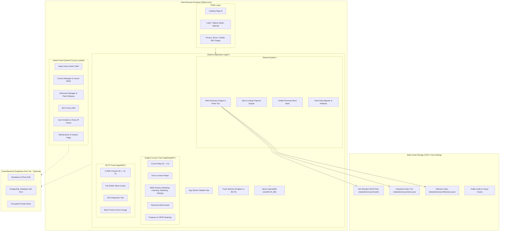

# Zarii Architecture & Technical Design

This document details the software architecture, module boundaries, two-track learning engine, dictionary pipeline, data flows, and security model of Zarii.

---

## 1. System Overview

Zarii is an **offline-first, zero-operating-cost web platform** designed to provide two complete learning paths:
1. **General English Course Track (`/app/english/*`)**: A CEFR-aligned curriculum from A1 Beginner to C1 Advanced with structured units, lessons, practice screens, skills studios, and placement testing.
2. **IELTS Preparation Track (`/app/ielts/*`)**: Authentic exam practice for Academic and General Training with full mock exams, scoring engines, diagnostic benchmarking, and band trend analysis.
3. **Shared Foundation**:
   - **Offline English Dictionary (`/app/dictionary`)**: 144,456 headwords, phonetic IPA, US/UK audio, inflections, safe mode, and tap-to-lookup.
   - **Cross-Track Word Bank (`/app/word-bank`)**: Central vocabulary repository where saved words can be tagged by track and practiced via SM-2 flashcards.
   - **Unified Settings & Storage (`/app/settings`)**: Offline pack management, database backups, and privacy controls.
4. **Admin Console (`/admin/*`)**: Isolated management portal for Course Curriculum, Dictionary Patches, Test Content, User Analytics, and Maintenance Controls.

---

## 2. High-Level Architecture Diagram

---

## 3. Data Flow & Migration Architecture

### Backward-Compatibility URL Routing
To preserve old student bookmarks and external links, all legacy routes permanently redirect preserving query parameters and URL params:
- `/practice/*` $\rightarrow$ `/app/ielts/practice/*`
- `/mock/*` $\rightarrow$ `/app/ielts/mock/*`
- `/vocab/*` $\rightarrow$ `/app/ielts/vocab/*`
- `/dashboard` $\rightarrow$ `/app/progress`
- `/lessons` $\rightarrow$ `/app/ielts/lessons`
- `/settings` $\rightarrow$ `/app/settings`

### Track Migration & Safe Rollback
On initialization, `runTrackMigration()` detects existing user records:
1. **Pre-Migration Snapshot**: Dumps complete IndexedDB state to `localStorage.setItem('zarii_track_migration_v1_backup', json)`.
2. **Atomic Tagging**: Modifies `attempts`, `writingSubmissions`, `speakingSessions`, `vocabProgress`, `studyPlan`, and `mistakes` within a Dexie read-write transaction, setting `track = 'ielts'` on un-tagged records.
3. **Idempotency**: Flags completion in `zarii_track_migration_v1_completed`.
4. **1-Click Rollback**: `rollbackTrackMigration()` restores the pre-migration snapshot and clears the migration flag.

---

## 4. Dictionary Pipeline & Sharding Architecture

To serve 144,456 comprehensive entries without loading large megabyte files in the browser:
- **Build Pipeline (`scripts/dictionary/build.cjs`)**:
  - Ingests Open English WordNet, CMU Pronouncing Dictionary, and word frequencies.
  - Normalizes ARPAbet phonetics into standard IPA and plain-text respelling.
  - Generates 622 static shard files grouped by prefix (e.g., `shard_aa.json`, `shard_ru.json`) with gzip sizes strictly under 100 KB.
  - Generates `index.json` (prefix trie) and `inflections.json` (144k inflected forms mapped to root headwords).
- **Client-Side Cache & Offline Mode**:
  - Search requests dynamically fetch only the relevant prefix shard on demand (debounced 120ms).
  - Downloaded shards are cached in IndexedDB.
  - Users can download the *Essential 20,000 Words Pack* (~12 MB) to enable 100% offline lookup without network requests.
- **Exam Mode Protection**:
  - `useTapToLookup` subscribes to active test modes. When timed reading or mock exams are active, the popover listener is completely detached.

---

## 5. Security & Isolation

- **Client-Side Privacy**: Student data, attempts, and dictionary lookups remain 100% on the student's device. No analytics trackers or telemetry scripts exist in production builds.
- **Admin Code Splitting**: All admin logic, course authoring tools, and dictionary patching systems are lazy-loaded exclusively within `/admin/*` chunks.
- **Database RLS Policies**: Row Level Security ensures students can only read published content and cannot access admin settings, drafts, or other users' private records.
