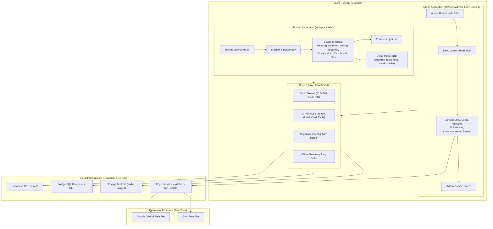

# Zarii IELTS Architecture Documentation

This document describes the high-level architecture, module boundaries, data flows, and security isolation of the Zarii IELTS platform.

---

## 1. System Overview

Zarii IELTS is designed as an **offline-first, zero-cost-to-run web application** for IELTS Academic and General Training preparation. It is split into two isolated applications sharing a common core:

1. **Student App (`/`)**: A fast, distraction-free learning environment that functions 100% offline via local IndexedDB (Dexie) and caches, with optional cloud sync when signed in.
2. **Admin App (`/admin`)**: A comprehensive management back-office for tests, question building, analytics, AI examiner prompt tuning, user administration, announcements, feedback, and system health.
3. **Shared Kernel (`src/shared`)**: Brand tokens, design system primitives, API client, Supabase client, and TypeScript domain types.
4. **Backend (Supabase Free Tier)**: PostgreSQL database with Row Level Security (RLS) on every table, Edge Functions for encrypted AI key proxying, and Storage for media assets.

---

## 2. High-Level Architecture Diagram



---

## 3. Module & Folder Structure

Every module across the platform strictly follows a standard, predictable hierarchy:

```
src/features/<module>/
├── components/          # Module-specific presentation and container components
│   └── index.ts
├── hooks/               # Custom lifecycle and state management hooks
│   └── index.ts
├── services/            # Business logic, content loaders, and calculations
│   └── index.ts
├── store/               # Zustand state stores for transient session state
│   └── index.ts
├── types.ts             # Domain-specific TypeScript models and interfaces
├── index.ts             # Module public barrel export
└── README.md            # Feature documentation and test guide
```

### The 8 Standardized Features:
1. `src/features/reading`: Dual-pane text reader, interactive IELTS question formats, auto-marking, Academic/General band scales.
2. `src/features/listening`: Sectional audio engine, speed controls, question timeline, transfer time runner.
3. `src/features/writing`: Task 1 & Task 2 distraction-free editor, chart viewer, AI evaluation, and $0 rule-based evaluation fallback.
4. `src/features/speaking`: Part 1-3 simulator, cue-card prep timer, Web Speech API speech-to-text, fluency heuristic engine.
5. `src/features/vocab`: SuperMemo-2 (SM-2) spaced repetition engine, flashcards, word bank, IELTS topic collocations.
6. `src/features/mock`: 3-hour exam pipeline (Listening -> Reading -> Writing -> Speaking) with official rounder.
7. `src/features/dashboard`: Performance analytics, score progression, target band milestones, study streak tracking.
8. `src/features/plan`: Algorithmic study schedule synthesis based on target band, exam date, and available study minutes.

---

## 4. Security & Role-Based Access Control (RBAC)

- **Student Isolation**: Admin routes (`/admin/*`) and components are dynamically code-split with `React.lazy()`. The student bundle contains zero admin navigation links.
- **Database Row Level Security (RLS)**:
  - `student`: Can read published tests and write to their own attempts/submissions.
  - `editor`: Can create, edit, and preview tests, vocabulary, grammar lessons, and reply to feedback.
  - `admin`: Full unrestricted access to users, system health, audit logs, AI provider secrets, and database backups.
- **AI Key Security**: AI keys (Gemini, Groq) are never sent to or stored in client-side code for admin functions; they reside server-side in Supabase Vault / Edge Function secrets. For students using "bring your own API key", keys remain strictly inside their personal browser `localStorage`.

---

## 5. Performance & Bundle Chunking Strategy

Configured in `vite.config.ts` to guarantee blazing-fast load times even on 3G cellular networks:
- **`index.js` (~230 kB / 64 kB gzip)**: Core student runtime, routing, and shell.
- **`AdminApp.js` (~355 kB)**: Lazy-loaded exclusively when visiting `/admin`.
- **`charts.js` (~427 kB)**: Recharts bundle loaded on-demand for analytics and progress screens.
- **Content Chunks**: Test datasets split by module (`content-reading`, `content-listening`, `content-vocab`, `content-subjective`), downloaded only when practicing that specific module.
